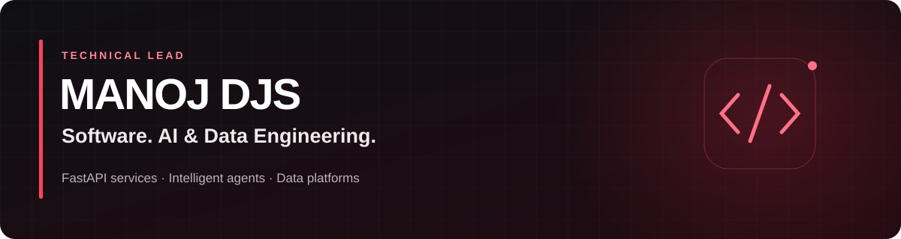

**[Portfolio](https://manojdjs-cv.netlify.app/)** · **[GitHub Pages](https://manojdjs.github.io/my_portfolio/)** · **[LinkedIn](https://www.linkedin.com/in/jaya-deep-satya-manoj-doddi-8b5064118/)** · **[Get in touch](mailto:djsmanoj0000@gmail.com)**

### Building reliable services and intelligent applications.

I’m **Manoj DJS**, a Technical Lead working across **software engineering, AI engineering and data engineering**, based in **Derby, United Kingdom**.

I build **FastAPI and Python services with test-driven development**, develop **AI agents with LangGraph and MLflow**, and connect them to **Azure and Databricks** data platforms. My experience includes data engineering and predictive maintenance for jet engines at **Expleo Group, working for Rolls-Royce**.

## What I’m working on

An **agentic AI web application**, bringing APIs, agents and data engineering together:

- **FastAPI & Python:** backend services, application integrations and REST APIs.
- **Test-driven development:** PyTest, unit and integration tests, and iterative refactoring.
- **LangGraph & MLflow:** agent workflows, evaluation and the AI application lifecycle.
- **Azure & Databricks:** AI workloads, retrieval-augmented generation and data pipelines, delivered with Docker, Kubernetes and Azure DevOps.

## Engineering toolkit

| Focus | Tools & practices |
| --- | --- |
| **Software engineering** | FastAPI · Python · REST APIs · Django REST Framework · Flask · TDD · PyTest |
| **Agentic & generative AI** | LangGraph · MLflow · LangChain · RAG · Embeddings · Vector Search · Model Serving · Evaluation |
| **Data engineering** | PySpark · Apache Spark · SQL · Pandas · Azure Databricks · Data Factory · Data Lake · Synapse |
| **Cloud & delivery** | Azure · Docker · Kubernetes · AKS · Azure DevOps · CI/CD · Git · Linux |

## Selected projects

| Project | What it explores |
| --- | --- |
| [**FastAPI End-to-End**](https://github.com/ManojDjs/fastapi_e2e) | API architecture and testing with Docker, Celery, Redis and SQL. |
| [**FastAPI Docker Boilerplate**](https://github.com/ManojDjs/fast_api_docker_boilerplate) | A Python API foundation packaged with Docker. |
| [**Engineering Portfolio**](https://github.com/ManojDjs/my_portfolio) | Experience, selected work, certifications and recommendations from colleagues and clients. |

## Qualifications

- **Microsoft Certified: Azure AI Cloud Developer Associate (AI-200)**
- **Databricks Certified Generative AI Engineer Associate**
- **Master’s degree in Advanced Computer Science** — Northumbria University

Explore my [full experience, education and certifications](https://manojdjs-cv.netlify.app/#experience), or read [what colleagues say about my work](https://manojdjs-cv.netlify.app/#recommendations).

---

**Let’s talk software, agents and data.** [Portfolio](https://manojdjs-cv.netlify.app/) · [LinkedIn](https://www.linkedin.com/in/jaya-deep-satya-manoj-doddi-8b5064118/) · [Email](mailto:djsmanoj0000@gmail.com)
